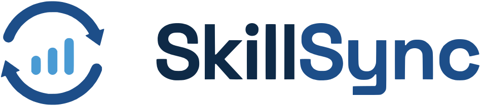

<p align="center">
  <picture>
    <source media="(prefers-color-scheme: dark)" srcset="docs/brand/skillsync-logo-dark.svg">
    
  </picture>
</p>

<p align="center"><b>Match făcut. Proiect început.</b></p>

# SkillSync

SkillSync (formerly GoBiz) is a working prototype of a platform for **micro-projects, internships and jobs**. It sits somewhere between an internship, freelancing and practical learning. SMEs post small, well-scoped problems they cannot staff internally (a Power BI dashboard, cleaning up a customer database, automating an Excel report). Students take them on to earn money and experience, and every completed collaboration goes into a verified portfolio. Universities mentor, validate and see which skills companies are actually asking for.

The central idea: instead of matching students with jobs, the platform matches **student skills with real company problems**. Students and companies **swipe right** on each other, Tinder-style; when both say yes it's a match and the chat opens. The matching algorithm **recommends, it never decides**: it orders the cards and explains each fit, students can still apply anywhere and companies can invite anyone.

```
Company describes a problem -> LLM extracts tasks + skills -> company confirms
 -> the engine ranks who fits -> student swipes right | company swipes right (or applies / invites)
 -> both said yes = match -> chat -> selection -> work -> delivery -> payment (simulated)
 -> mutual reviews -> verified portfolio
```

## Presentation

- [Slides (PDF, 18 pages)](docs/presentation/SkillSync-presentation.pdf)
- [Demo video (30 s, MP4, no captions)](docs/presentation/SkillSync-demo.mp4): student swipe and match, chat, the local AI reading a company's text, the company swiping, the professor's insights, dark mode
- [Demo video in Romanian (30 s, MP4, no captions)](docs/presentation/SkillSync-demo-ro.mp4): the RO / EN switch, then logging in (typing the test account) and out of all three accounts: the student's swipe match, the company's AI extraction in Romanian (qwen3:1.7b on the GPU) and its swipe match, the professor's statistics and dark mode
- All are generated from the running app by [docs/presentation/make_presentation.py](docs/presentation/make_presentation.py) (Playwright + ffmpeg, open source): `python docs/presentation/make_presentation.py [pdf] [video] [video-ro]`
- Brand: [logo (light)](docs/brand/skillsync-logo.svg), [logo (dark)](docs/brand/skillsync-logo-dark.svg), [mark](docs/brand/skillsync-mark.svg), traced to SVG from the original [PNG](docs/brand/skillsync-logo-original@2x.png)

## Contents

1. [Features](#features)
2. [Technologies used](#technologies-used)
3. [Architecture](#architecture)
4. [The LLM (placeholder) and why this model](#the-llm-placeholder-and-why-this-model)
5. [The matching algorithm](#the-matching-algorithm)
6. [Running it](#running-it)
7. [Tests and evaluation](#tests-and-evaluation)
8. [Project structure](#project-structure)
9. [API](#api)
10. [Limitations and next steps](#limitations-and-next-steps)

## Features

**Three tabs:** Projects, Internships and Jobs. Each side declares what it is interested in. A year-2 student may want only the mandatory practice internship; another student may only want a project they can get course credit for.

**Swipe matching (the Match page, for students and companies)**
- Students get a card deck of open opportunities, best fit first; companies get a deck of students for all their open opportunities or for one of them. Clear mismatches ("Not a fit") are left out.
- Drag the card (with *Yes* / *Pass* stamps), use the ✕ / ♥ buttons or the ← → keys. Undo brings back the last card.
- A right swipe stays private. When the other side also swipes right: **"It's a match!"** (a short celebration with the logo), a ready-to-send first message, and the conversation appears in Messages.
- Applying counts as the student's right swipe and inviting as the company's, so the classic buttons and the decks agree (a company that liked you + you apply = instant match).
- A match is not a hiring decision: the company still selects who does the work (matches appear in a *Matches* tab next to Applicants and Invited).

**Student**
- Profile: university, faculty, year, courses, skills at levels 0-3 plus a separate "want to learn" flag, self-declared projects, availability (hours/week, period, remote/on-site/hybrid), goals (paid project, course credit, mandatory practice, thesis, internship, part-time or full-time job), domains of interest, GitHub/portfolio links.
- **CV section** (top of the profile, and on the dashboard until a CV is uploaded): drag & drop or choose a file (PDF/DOC/DOCX/ODT, max 5 MB), open, replace, remove. A "Fill my profile from my CV" button is already in place, marked *Coming soon*: the next step is for the local LLM to read the CV and pre-fill skills, courses and projects for the student to confirm.
- Personalised recommendations per tab, with a score and an explanation (Power BI ✓ · SQL ✓ · availability ✓ · similar experience ✓ · to clarify: ...).
- Explore shows **every** opportunity (incompatible ones included, marked "Not a fit") with filters: skill, work mode, University Verified, mentoring, course credit / practice / thesis.
- Apply, accept or decline invitations, withdraw, request university mentorship, mark work as delivered, review the company.
- **Verified portfolio:** "2 completed projects · 2 Excel · 1 Power BI · rating 4.8/5", built only from collaborations completed on the platform and reviewed by the company.

**Company (SME)**
- 4-step "Post opportunity" wizard: free-text description (Romanian or English) -> **AI extraction** (tasks, explicitly mentioned skills, suggested skills, open questions) -> confirm skills (minimum level, *required from day one*, *can be learned with guidance*) -> details (hours, duration, dates, mode, pay, academic use, mentoring, University Verified request) -> publish, with the top recommended students shown immediately.
- Candidates for each opportunity: **AI Match** (all students ranked), **Applicants**, **Invited**, each with a "Why this score?" breakdown.
- Talent search across all students with skill/level filters, ranked against a chosen opportunity, plus direct invitations.
- Collaboration pipeline: Open -> In progress -> Delivered -> Paid -> Completed. The company's review closes the loop and adds the project to the student's portfolio.
- Messaging scoped to each opportunity.

**University**
- Dashboard: opportunities by type, average pay, **most requested skills**, **skill gap** (share of opportunities asking for a skill vs. share of students who have it at intermediate+ level, plus how many want to learn it), domains in demand, skills requested together (Neo4j when enabled), academic use.
- University Verified queue (approve/reject) and mentorship requests (accept/decline).

**Platform**
- **Romanian and English.** A RO | EN switch in the header (and in the footer and the mobile menu) changes the whole interface at once. The first visit follows the browser language; the choice is remembered. Texts produced by the server follow the same language: match explanations ("Îndeplinește 4 din 4 abilități..."), skill and domain names, error messages, the questions and reasons from the AI extraction, the automatic chat messages. Content written by people (titles, descriptions, messages, reviews) stays as written, so part of the demo data is in English and part in Romanian. The slogan is "Match făcut. Proiect început." in Romanian and "Match made. Project started." in English.
- Light/dark toggle, responsive (375px to 1440px), keyboard navigation, visible focus, AA contrast, `prefers-reduced-motion` respected, table view for every chart.
- A "System & AI status" page: is Ollama reachable, is the model downloaded, which embedding backend is active, is Neo4j connected, the current weights, demo reset.
- Every interaction (view, swipe, match, apply, invite, accept/decline, selection, completion, rating) is logged in `interaction_events`, the training data for a future learned ranker.

## Technologies used

All components are **open source** and free. No paid services, no accounts, no external APIs.

### Backend

| Technology | Version | License | Role |
|---|---|---|---|
| Python | 3.12 | PSF | language |
| FastAPI | 0.142 | MIT | REST API |
| Uvicorn | 0.54 | BSD-3 | ASGI server |
| SQLAlchemy | 2.1 | MIT | ORM (MySQL + SQLite) |
| PyMySQL + cryptography | 1.2 / 50 | MIT / Apache-2.0 | MySQL driver |
| Pydantic + pydantic-settings | 2.13 / 2.15 | MIT | validation, config from env |
| httpx | 0.28 | BSD-3 | HTTP client for Ollama |
| sentence-transformers | 6.1 | Apache-2.0 | text embeddings |
| PyTorch (CPU build) | 2.14 | BSD-3 | runtime for embeddings |
| neo4j (Python driver) | 6.3 | Apache-2.0 | knowledge graph client |
| pytest | 9.1 | MIT | tests |

### AI models

| Model | License | Size | Role |
|---|---|---|---|
| **Qwen3 1.7B** (`qwen3:1.7b`) via **Ollama** | Apache-2.0 / Ollama MIT | ~1.4 GB | requirement extraction from company text, structured JSON output (default) |
| Qwen3 4B (`qwen3:4b`), optional | Apache-2.0 | ~2.5 GB | better extraction on GPUs with 6 GB+ of VRAM |
| **paraphrase-multilingual-MiniLM-L12-v2** | Apache-2.0 | ~470 MB, 384 dims | semantic similarity (Romanian + English) |

### Data

| Technology | Version | License | Role |
|---|---|---|---|
| MySQL Community | 8.4 | GPL-2.0 | main database |
| Neo4j Community | 5.26 LTS | GPL-3.0 | optional skill knowledge graph |
| SQLite | (built-in) | public domain | fallback for local development and tests |

### Frontend

| Technology | Version | License | Role |
|---|---|---|---|
| React | 18.3 | MIT | UI |
| TypeScript | 5.6 | Apache-2.0 | typing |
| Vite | 6.4 | MIT | build / dev server |
| Tailwind CSS | 4.3 | MIT | styling (design tokens in CSS variables) |
| React Router | 6.30 | MIT | routing |
| TanStack Query | 5 | MIT | server state, cache |
| Recharts | 2.15 | MIT | university dashboard charts |
| lucide-react | 0.468 | ISC | SVG icons |
| Plus Jakarta Sans (@fontsource) | 5 | OFL-1.1 | font, self-hosted (no Google Fonts calls) |
| clsx | 2.1 | MIT | conditional classes |

### Infrastructure

| Technology | License | Role |
|---|---|---|
| Docker Engine + Docker Compose | Apache-2.0 | orchestration: one project "skillsync" with 3 containers (+ Neo4j on demand) |
| Node.js | 20, MIT | frontend build (only inside the image build stage) |

> Note: **Docker Desktop** (the Windows app) is proprietary software, free for personal use, education and small businesses. The `docker-compose.yml` file works unchanged with open-source alternatives: **Podman Desktop** (Apache-2.0) or **Rancher Desktop** (Apache-2.0), or Docker Engine installed directly in WSL2.

### Tooling (presentation and brand assets only, not part of the app)

| Technology | License | Role |
|---|---|---|
| Playwright (Python) + Chromium | Apache-2.0 / BSD-3 | screenshots, PDF slides, screen recording for the demo video |
| ffmpeg with libx264 (via imageio-ffmpeg) | GPL / BSD-2 | encoding the demo video to MP4 (H.264) |
| potracer | GPL-2.0 | tracing the logo PNG into SVG paths (one-time) |
| Pillow, NumPy | MIT-CMU / BSD-3 | preparing the logo image before tracing |

### Design

The design system was generated with the ui-ux-pro-max skill and saved in [design-system/skillsync/MASTER.md](design-system/skillsync/MASTER.md). The brand colors come from the SkillSync logo: navy `#0E2A47`, blue `#1D4E89` (primary) and light blue `#4A9BD4`, plus an orange CTA, Plus Jakarta Sans, restrained glassmorphism (navigation and dialogs only), light theme by default plus a dark theme (where the wordmark turns light). The logo is inline SVG ([frontend/src/components/Logo.tsx](frontend/src/components/Logo.tsx)), so it stays sharp at any size and follows the theme. Text color pairs are checked for AA contrast; chart colors were checked with a palette validator (color-vision deficiency separation, contrast) in both themes.

## Architecture

```
  Docker project "skillsync"
  ┌──────────────────────────────────────────────┐
  │ skillsync-app  (:8080)                       │
  │   React UI (built)  +  FastAPI /api, /docs   │
  │   llm/       extraction ──────────────────────┼──▶ skillsync-ollama (:11434)  qwen3:1.7b on the GPU
  │   matching/  engine + embeddings (in-proc)   │
  │   graph.py   optional ────────────────────────┼──▶ skillsync-neo4j (:7474/:7687)  only with --profile graph
  └──────────────────────┬───────────────────────┘
                         ▼
                 skillsync-mysql (:3307 on host)
```

### Why 3 containers and not 1

The app (UI + API) is already a single container: the Dockerfile builds React with Node and copies the result into the Python image, which serves both. MySQL and Ollama stay separate on purpose:

- they are official images, updated by their maintainers; folding them into one image means maintaining a database server and an LLM runtime by hand;
- only Ollama needs the GPU; the GPU override applies to that container alone;
- a code change rebuilds only `skillsync-app` (seconds to minutes), not the 9 GB Ollama image or the database;
- data and models live in their own volumes (`mysql_data`, `ollama_data`, `hf_models`), so containers can be recreated without losing anything;
- one process per container keeps health checks, restarts and logs separate.

In Docker Desktop all of them appear grouped under the **skillsync** project, with readable names (`skillsync-app`, `skillsync-mysql`, `skillsync-ollama`, `skillsync-neo4j`). `docker compose down` stops the whole project at once.

Coming from the old **gobiz** project? Copy the model volumes instead of downloading them again (afterwards the old `gobiz_*` volumes can be removed with `docker volume rm`):

```bash
docker run --rm -v gobiz_ollama_data:/from:ro -v skillsync_ollama_data:/to --entrypoint sh mysql:8.4 -c "cp -a /from/. /to/"
docker run --rm -v gobiz_hf_models:/from:ro -v skillsync_hf_models:/to --entrypoint sh mysql:8.4 -c "cp -a /from/. /to/"
```

Every AI component has a deterministic fallback, so the application works even when one of them is missing:

| Component | When it is unavailable |
|---|---|
| Ollama / LLM | rule-based extractor (skill catalog with RO/EN synonyms, cue words for "required", "nice to have", level) |
| embedding model (still downloading or offline) | hashed bag-of-words embedding with skill-name normalisation |
| Neo4j | the same statistics computed in SQL |

## The LLM (placeholder) and why this model

**The constraint:** open source, free, local, running on an i5-9400F, 16 GB DDR4 and a **GTX 1050 Ti with 4 GB VRAM**.

**The choice: Qwen3 through Ollama, with `qwen3:1.7b` as the default.**
- Apache-2.0 license (genuinely open source). Llama 3.x (Llama Community License) and Gemma (Gemma Terms of Use) were excluded because their licenses are not OSI-approved.
- It supports Ollama **structured outputs**: the backend sends the JSON schema in the `format` field, so the response is valid JSON matching the schema. `think: false` turns off Qwen3's reasoning mode, and `num_predict` caps the answer length.
- Supports Romanian.

**Measured on the target PC** (GTX 1050 Ti 4 GB, i5-9400F, Ollama in Docker Desktop / WSL2, October 2026):

| Model | Where it ran | Speed | Extraction of a Romanian description |
|---|---|---|---|
| `qwen3:4b` | GPU, 27 of 37 layers (the rest did not fit) | 0.4 tokens/s | timeout after 120 s |
| `qwen3:4b` | CPU only | 1.8 tokens/s | not run end to end (estimated ~3 min for a ~350-token answer) |
| **`qwen3:1.7b`** | **GPU, 29 of 29 layers** | **~34 tokens/s** | **7-15 s** |

Why `qwen3:4b` is so slow on this card: the GTX 1050 Ti also drives the Windows display, so only ~3.3 GB of VRAM is free. Weights + KV cache do not fit, and the driver spills GPU memory into system RAM. `qwen3:1.7b` fits entirely in VRAM. On a GPU with 6 GB or more, set `OLLAMA_MODEL=qwen3:4b` for better extraction. Other options: `qwen2.5:3b`, `phi4-mini` (MIT).

**Hybrid extraction: the LLM proposes, rules verify.** A 1.7B model sometimes misses explicit wording ("Power BI este obligatoriu") or a tool named in passing. The backend therefore also runs the rule-based extractor on the same text and merges the two: required/optional comes from the cue words at clause level, skills named verbatim but skipped by the model are added back, and empty fields (domain, summary) are filled in. On the example above, the raw qwen3:1.7b answer had Power BI as optional and no Excel; after the merge, Power BI is required, SQL optional, Excel explicit.

**How it is used** (`backend/app/llm/`):
1. The company writes the description; the backend calls `POST /api/chat` on Ollama with the system prompt and the `Extraction` schema (summary, tasks, skills_explicit with *evidence*, skills_suggested with *reason*, missing_info, domain, difficulty), then merges the answer with the rule-based pass.
2. **Post-processing that the LLM cannot bypass:**
   - skill names are normalised to the shared catalog (the same ids in the student form and the company form; labels follow ESCO where a close ESCO concept exists);
   - an "explicit" skill whose quote (`evidence`) does not appear in the text is downgraded to "suggested" (anti-hallucination);
   - a suggestion is **never** made mandatory automatically;
3. The company confirms or edits everything before publishing. The raw LLM output is kept in `opportunities.ai_extraction` for audit.

## The matching algorithm

A **content-based recommender** that combines explicit skill matching, hard filters and semantic search, as described in the design discussion. Code: [backend/app/matching/engine.py](backend/app/matching/engine.py) (pure functions, no DB, unit-testable).

**1. Hard filters** decide the status:

| Check | Result when not met |
|---|---|
| opportunity type is among the types the student wants | incompatible |
| student hours/week >= required hours | incompatible |
| availability period overlaps (when both are declared) | incompatible |
| remote-only student vs on-site role | incompatible |
| hybrid role / on-site in another city | to clarify |
| required skill declared **below** the minimum level | incompatible, **unless** the company marked it *learnable with guidance* and the student marked *want to learn* |
| required skill **not declared** | to clarify |

A very similar description cannot make up for a student who is unavailable in that period.

**2. Score** (default weights from the discussion, configurable through `W_SKILLS`, `W_EXPERIENCE`, `W_INTERESTS`, `W_SEMANTIC`):

```
score = 100 × (0.50·skills + 0.25·experience + 0.15·interests + 0.10·semantic)
```

- **skills:** weighted coverage of requirements (required ×2, optional ×1). Level met = 1; learnable + wants to learn = 0.5; optional skill below the level = proportional; related skill at the required level (catalog relations / knowledge graph) = 0.3.
- **experience:** completed and verified SkillSync projects with overlapping skills or the same domain (weighted by rating) + self-declared projects (0.5 each), saturating at 2.
- **interests:** domain match + goal match (the opportunity offers course credit and the student wants course credit, and so on).
- **semantic:** cosine similarity between `paraphrase-multilingual-MiniLM-L12-v2` embeddings. The model accepts at most 128 tokens, so texts are split into chunks of about 55 words; the score is the mean, over the opportunity's chunks, of the best match among the student's chunks. Vectors are cached in the DB (hash of text + model) and recomputed only when the text changes.

**3. Explanation:** ✓ / ~ / ≈ / ✗ for each skill, checks (type, availability, period, mode, experience), the "to clarify" list and a plain-language summary. The interface states it explicitly: the score orders options, it is **not a probability of success**.

**4. Ordering:** incompatible results last; "to clarify" results ranked by score next to "evaluated" ones. "Recommended for you" hides incompatible results and scores below 40; Explore shows everything.

**5. Swipe decks** ([backend/app/routers/swipes.py](backend/app/routers/swipes.py)): the same ranking, as cards. The student deck holds open opportunities the student has not swiped or applied to (pending invitations included, marked "They invited you"); the company deck holds students not yet swiped for each open opportunity (pending applicants included, marked "Applied"). Incompatible pairs are not shown. Each side's swipe is a row in `swipes`; a right swipe checks whether the other side already said yes (a right swipe, an application or an invitation). If so, the pair becomes an `Application` with `kind = "match"`, which opens messaging and can be selected by the company.

**Learning later:** the cold-start problem is avoided by starting with explainable rules. All interactions are logged in `interaction_events`; once enough real data exists, they can be used to adjust the weights or train a learned ranker.

**Knowledge graph (optional, Neo4j):**
`(:Student)-[:HAS_SKILL {level}]->(:Skill)<-[:REQUIRES {min_level, mandatory}]-(:Opportunity)`, `(:Skill)-[:RELATED_TO]-(:Skill)`, `(:Company)-[:POSTED]->(:Opportunity)`, `(:Student)-[:COMPLETED {rating}]->(:Opportunity)`. It syncs automatically from MySQL and powers "skills requested together" and the skill neighbourhood (`GET /api/graph/skills/{id}`). The Neo4j Browser at http://localhost:7474 lets you explore the graph visually.

## Running it

### Option A: Docker (the full stack)

Requirements: Docker Desktop (WSL2) or Podman/Rancher Desktop, roughly 10 GB of free disk space.

```bash
cp .env.example .env
docker compose up --build
```

- App: **http://localhost:8080** · API docs (Swagger): http://localhost:8080/docs
- On first start the app asks Ollama to download `qwen3:1.7b` (~1.4 GB) and downloads the embedding model (~470 MB) into a volume. Until they are ready the application works on the fallbacks; check the **System & AI status** page.

**With the GPU (GTX 1050 Ti):** needs a recent NVIDIA driver on Windows (WSL2 support is included).

```bash
docker compose -f docker-compose.yml -f docker-compose.gpu.yml up --build
```

**With the Neo4j knowledge graph:** uncomment `NEO4J_URI=bolt://neo4j:7687` in `.env`, then:

```bash
docker compose --profile graph up --build
```

Neo4j Browser: http://localhost:7474 (user `neo4j`, password from `NEO4J_PASSWORD`).

### Option B: local development (no Docker)

Uses SQLite instead of MySQL; everything else is identical.

```bash
cd backend
python -m venv .venv
.venv/Scripts/pip install torch --index-url https://download.pytorch.org/whl/cpu
.venv/Scripts/pip install -r requirements.txt
.venv/Scripts/python -m uvicorn app.main:app --reload --port 8000
```

```bash
cd frontend
npm install
npm run dev
```

App: http://localhost:5173. For the LLM, install Ollama natively (https://ollama.com, MIT) and run `ollama pull qwen3:1.7b`; without it the rule-based extractor is used.

### Demo accounts (mock login)

Open http://localhost:8080 (Docker) or http://localhost:5173 (local development) and log in. The login page lists these accounts; clicking one logs you in.

| Account | Role | Username | Password |
|---|---|---|---|
| Test Student | student | `teststudent` | `test123` |
| Test SRL | company | `testsrl` | `test123` |
| Test Professor | professor (university) | `testprofessor` | `test123` |

The demo data is deliberately small: 2 students (Test Student and Maria Ionescu), 2 companies (Test SRL and Demo Logistics SRL) and 1 professor. Maria Ionescu and Demo Logistics SRL have no login; they exist so that companies see more than one candidate and students see more than one company. The data is fictional and resets from **System & AI status -> Reset demo data**.

The login is a **mockup**: the server checks the password (PBKDF2 hash), but afterwards the app identifies the user through the `X-User-Id` header, which any client could forge. Fine for a prototype, not for production.

Things to try:
- **Test Student:** open **Match** and swipe right on "Sales dashboard in Power BI": Test SRL already liked you, so it's an instant match. The dashboard also shows an invitation, a project in progress and the CV section.
- **Test SRL:** open **Match** and swipe right on Maria Ionescu (she applied to "New design for our online shop", so that's a match too). *Post an opportunity* -> *Fill with an example* (Romanian text) -> *Analyze with AI*. On "New design for our online shop" you can select her.
- **Test Professor:** *Insights* (charts), the University Verified queue and a mentorship request from Test Student.

## Tests and evaluation

```bash
cd backend
.venv/Scripts/python -m pytest -q                    # 45 tests: filters, scores, extraction, login, CV, swipes, languages, full API flow
.venv/Scripts/python -m scripts.evaluate_matching    # precision@5 / recall@5 / MRR vs baselines
```

```bash
cd frontend
npm run typecheck && npm run build
```

`evaluate_matching` compares, on manually labelled pairs ([backend/scripts/eval_labels.json](backend/scripts/eval_labels.json)), the full engine against a **skills-only** baseline and a **semantic-only** baseline, as the discussion recommended. It runs on its own larger dataset ([backend/scripts/eval_dataset.py](backend/scripts/eval_dataset.py): 14 students, 8 companies, 18 opportunities), separate from the small app demo. Results:

| Ranker | Embeddings | P@5 | R@5 | MRR |
|---|---|---|---|---|
| full engine | multilingual MiniLM | 0.333 | 0.926 | 1.000 |
| skills only | (none) | 0.333 | 0.926 | 1.000 |
| semantic only | multilingual MiniLM | 0.311 | 0.875 | 0.886 |

Semantic similarity alone ranks worse than the skill rules, which supports giving it only 10% of the score. On a set this small the full engine and the skills-only baseline tie; the script is the tool for tuning the weights once there is real data. (P@5 is capped because most opportunities have fewer than 5 relevant students.)

## Project structure

```
SkillSync/
├─ Dockerfile                  one image: builds React, then runs FastAPI serving UI + API
├─ docker-compose.yml          project "skillsync": app, MySQL, Ollama, Neo4j (profile "graph")
├─ docker-compose.gpu.yml      override: Ollama on an NVIDIA GPU
├─ .env.example
├─ design-system/skillsync/    design system (ui-ux-pro-max) + brand colors
├─ docs/brand/                 logo: SVG light/dark, mark, original PNG
├─ docs/presentation/          PDF slides, 30 s demo video and the script that makes them
├─ docs/superpowers/specs/     design spec
├─ backend/
│  ├─ app/
│  │  ├─ main.py               FastAPI app, startup (wait for DB, seed, embeddings, graph)
│  │  ├─ config.py             settings from env
│  │  ├─ i18n.py               Romanian / English texts of the API (Accept-Language), error translation
│  │  ├─ models.py             SQLAlchemy: users, profiles, skills, opportunities, applications,
│  │  │                         swipes, messages, reviews, mentorship, interaction_events
│  │  ├─ skills_catalog.py     ~45 skills, RO/EN synonyms, relations, normalisation
│  │  ├─ llm/                  schema, Ollama + heuristic providers, extraction + post-processing
│  │  ├─ matching/             engine (pure), embeddings (chunking, cache), service (DB <-> engine)
│  │  ├─ graph.py              Neo4j sync + queries with SQL fallback
│  │  ├─ routers/              meta, ai, students, companies, opportunities, applications, swipes, messages, university
│  │  └─ seed.py               demo data
│  ├─ scripts/evaluate_matching.py
│  └─ tests/
└─ frontend/
   ├─ src/pages/               Home, Explore, Swipe (Match), OpportunityDetail, Student*, Company*,
   │                            PostOpportunity, Talent, Messages, UniversityDashboard, SystemStatus, About
   ├─ src/lib/i18n.tsx         language switch; each component keeps its RO + EN texts next to it,
   │                            checked by TypeScript (a missing Romanian text is a build error)
   ├─ src/components/          Layout, Logo, SwipeDeck, MatchCta, Match (score + breakdown),
   │                            OpportunityCard, Chat, Pipeline, ui
```

## API

Full interactive documentation: http://localhost:8080/docs (Docker) or http://localhost:8000/docs (local development). After the mock login (`POST /api/auth/login`), the app identifies the user through the `X-User-Id` header. Every endpoint answers in Romanian with `Accept-Language: ro` and in English otherwise (only the generated texts change, never the data or the ranking).

| Method | Route | Who |
|---|---|---|
| POST | `/api/auth/login` · GET `/api/auth/demo-accounts` · GET `/api/me` | all |
| GET | `/api/opportunities?type=&skill=&work_mode=&verified=&academic=&sort=match` | all (with match for students) |
| POST | `/api/ai/extract` | company |
| POST / PUT | `/api/opportunities`, `/api/opportunities/{id}` | company |
| GET | `/api/opportunities/{id}/candidates` | owning company |
| POST | `/api/opportunities/{id}/apply` · `/invite` · `/select` · `/status` · `/reviews` · `/mentorship` | student / company |
| GET / PUT | `/api/students/me`, `/api/students/me/recommendations`, `POST` / `DELETE /api/students/me/cv` | student |
| GET | `/api/students?skill=&min_level=&opportunity_id=` | company, university |
| GET | `/api/swipe/student/deck` · `/api/swipe/company/deck?opportunity_id=` · `/api/swipe/matches` | student / company |
| POST | `/api/swipe` (`{opportunity_id, student_id?, liked}`) · `/api/swipe/undo` | student, company |
| GET / POST | `/api/messages/threads`, `/api/messages` | student, company |
| GET | `/api/university/dashboard`, `/verification-queue`, `/mentorship` | university |
| GET | `/api/system/status`, `/api/graph/skills/{id}` | all |

## Limitations and next steps

- **Authentication:** mock login with 3 test accounts. Next step: OIDC (e.g. Keycloak, Apache-2.0) and signed tokens instead of the `X-User-Id` header.
- **Payment** is only a status (the company confirms payment). A real integration needs a payment provider and contracts.
- **CV autofill:** the CV is stored and shown to companies, but not read yet. The "Fill from CV" button is ready for the same local LLM to extract skills, courses and projects for the student to confirm.
- **Learned ranker:** once there are enough interactions, train a model (e.g. LightGBM LambdaRank, MIT) on `interaction_events` (swipes give many cheap labels) and compare it with the current engine using `evaluate_matching`.
- **Repository name:** the GitHub repository is still called `gobiz`; it can be renamed to `skillsync` in the repository settings (GitHub redirects the old URL).
- **Full ESCO catalog:** the current catalog is small and ESCO-inspired; it can be extended with ESCO labels in Romanian.
- **GDPR:** consent for processing, data retention, export/deletion of an account before going live.
